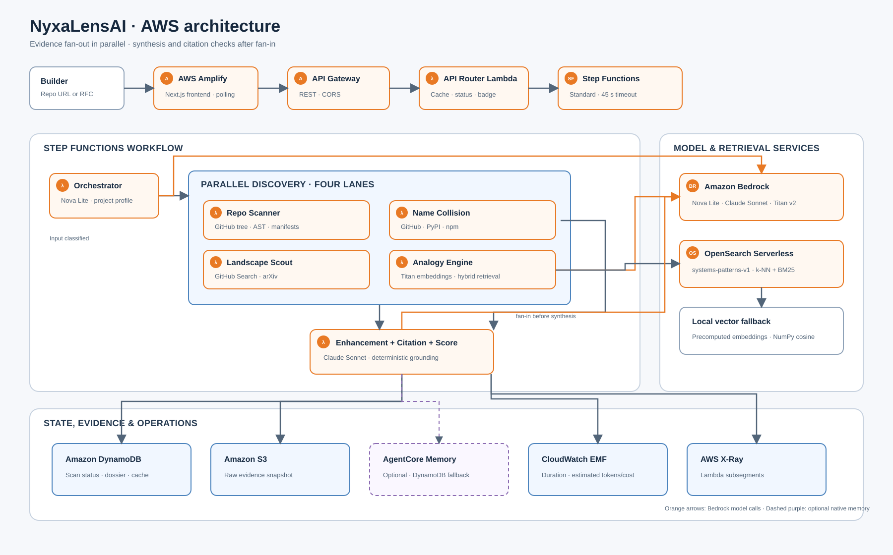

# NyxaLensAI

> **See in the dark. Build in the light.**

NyxaLensAI is an AWS based architectural review tool for public GitHub repositories and Markdown RFCs. It gathers repository, ecosystem, name collision, and cross domain pattern evidence, then produces a reviewable Enhancement Dossier with recommendations and a 0–100 score.

**Project status:** local implementation and fixtures are available; AWS deployment and public hosting have not been verified. Treat model output and scores as engineering aids that require human review.

## Architecture



The API starts a Step Functions execution. An orchestrator prepares a typed project profile, four discovery Lambdas run in parallel, and synthesis runs after discovery completes. The synthesis worker grounds citations against retrieved URLs, calculates deterministic score points, and persists the dossier. DynamoDB stores scan state and session memory; S3 stores raw evidence. Bedrock AgentCore Memory is optional and falls back to DynamoDB.

The diagrams show the CDK design, not a deployed AWS environment. See the [Builder Center article](docs/BUILDER_CENTER_ARTICLE.md) for design details and implementation caveats.

## Capabilities

- Scan a public GitHub repository or Markdown RFC.
- Inspect a bounded set of repository files and dependency manifests.
- Check candidate names against GitHub, PyPI, and npm.
- Search GitHub and arXiv for related work.
- Retrieve engineering patterns from a 20-record corpus using OpenSearch Serverless or a local vector fallback.
- Produce Kill / Keep / Inject recommendations, a ranked backlog, Mermaid diagram, citation count, and Nyxa Score.
- Rescan with a parent scan ID and show score delta.
- View three bundled offline demo dossiers without AWS.

NyxaLensAI does not modify scanned repositories, establish trademark rights, prove novelty, or guarantee that a recommendation is safe or beneficial.

## Pipeline

| Stage | Work |
| --- | --- |
| API | Validate request, check 24-hour cache, start workflow |
| Orchestrator | Classify input and build `UniversalProjectProfile` with Nova Lite |
| Parallel discovery | Repo scan; name checks; ecosystem research; pattern retrieval |
| Sequential synthesis | Claude Sonnet drafts the dossier after all discovery lanes finish |
| Grounding and scoring | Remove URLs absent from raw discovery evidence; calculate deterministic and rubric points |
| Persistence | Store scan and dossier in DynamoDB; raw evidence in S3 |

Models configured in the CDK stack: `amazon.nova-lite-v1:0`, `anthropic.claude-3-5-sonnet-20241022-v2:0`, and `amazon.titan-embed-text-v2:0`. Confirm model access in your selected AWS region before deployment.

## Quick start: local checks and demos

### Requirements

- Python 3.12
- Node.js 22 or newer
- `make` (or equivalent commands from the Makefile)
- Docker for CDK Lambda asset bundling during synth/deploy

Install dependencies:

```bash
make bootstrap
```

Run checks:

```bash
make lint
make test
make test-integration
cd frontend && npm test && npm run build
```

Run the frontend with the offline demo fixtures:

```bash
cd frontend
npm run dev
```

Open the local site and select a curated demo. Live scans need a deployed API and `NEXT_PUBLIC_API_URL`.

## AWS deployment

Deployment creates billable AWS resources, including OpenSearch Serverless. Review the [deployment runbook](DEPLOYMENT.md), configure credentials and model access, then deploy only in an account you control.

```bash
# Create the GitHub token secret as described in DEPLOYMENT.md.
make bootstrap
cdk synth --app "python app.py" # from cdk/ after activating the Python environment
make deploy
python data/seed_opensearch.py --mode aoss
```

For a demo teardown, run `python data/seed_opensearch.py --mode local` if local vector fallback is needed, then `make destroy`. Teardown does not remove data or resources created outside this CDK stack.

## API routes

| Method and path | Purpose |
| --- | --- |
| `POST /scans` | Submit repo URL or RFC text; returns cached `200` or new `202` scan |
| `GET /scans/{scan_id}` | Read scan status and dossier |
| `GET /badge/{scan_id}` | Return Nyxa Score SVG badge |

The API is asynchronous. Clients poll the scan route until completion or failure.

## Repository layout

```text
cdk/                  AWS CDK application and stack
lambdas/              API, orchestration, discovery, synthesis, and shared clients
data/                 20-pattern ontology and OpenSearch/local seeder
frontend/             Next.js App Router client
tests/                Python unit/integration tests and demo fixtures
docs/                 Scoring rubric, deployment article, and visual assets
.github/workflows/    CI checks
```

## Limitations and security notes

- Repository scanning supports public GitHub repositories and inspects a bounded file set; it is not a full static analyzer.
- Name checks and score dimensions are heuristics. A GREEN result is not trademark clearance.
- Pattern matches and projected score lifts are estimates, not measured repo benchmarks.
- Citation grounding proves that a URL appeared in retrieved evidence; it does not verify the page's current content.
- AWS deployment, real model latency/cost, and Amplify hosting are not verified in this repository.
- The current AOSS network policy allows public network reachability and relies on IAM data access controls. Restrict it before production use.
- The frontend currently uses Next.js 14; upgrade to a supported release before production deployment.
- Never commit AWS credentials, GitHub tokens, `.env` files, private repository content, or customer scan data.

Report vulnerabilities using the private process in [SECURITY.md](SECURITY.md). See [ACCESSIBILITY.md](ACCESSIBILITY.md) for accessibility goals and known scope.

## Copyright and reuse

Copyright © 2026 NyxaLensAI project owner. All rights reserved. This repository has no open-source license. No permission is granted to copy, download for reuse, redistribute, modify, or create derivative works from this project. Access to a private repository is limited to invited users, but invited users can still retain local copies; repository visibility and access controls reduce exposure but cannot technically prevent copying by an authorized viewer. See [LICENSE](LICENSE).

## Further reading

- [AWS deployment runbook](DEPLOYMENT.md)
- [Builder Center technical article](docs/BUILDER_CENTER_ARTICLE.md)
- [Nyxa Score rubric](docs/SCORING_RUBRIC.md)
- [Security policy](SECURITY.md)
- [Accessibility statement](ACCESSIBILITY.md)
- [Contributing guide](CONTRIBUTING.md)
